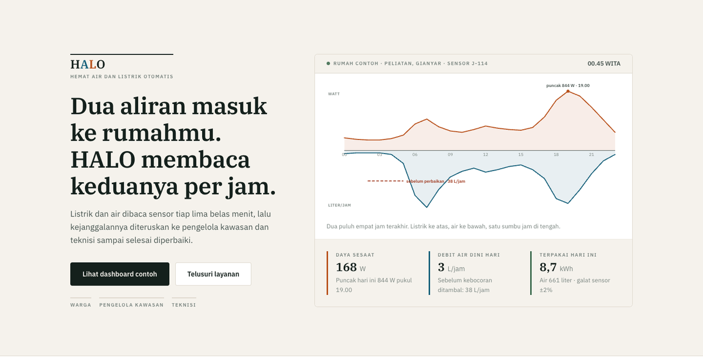
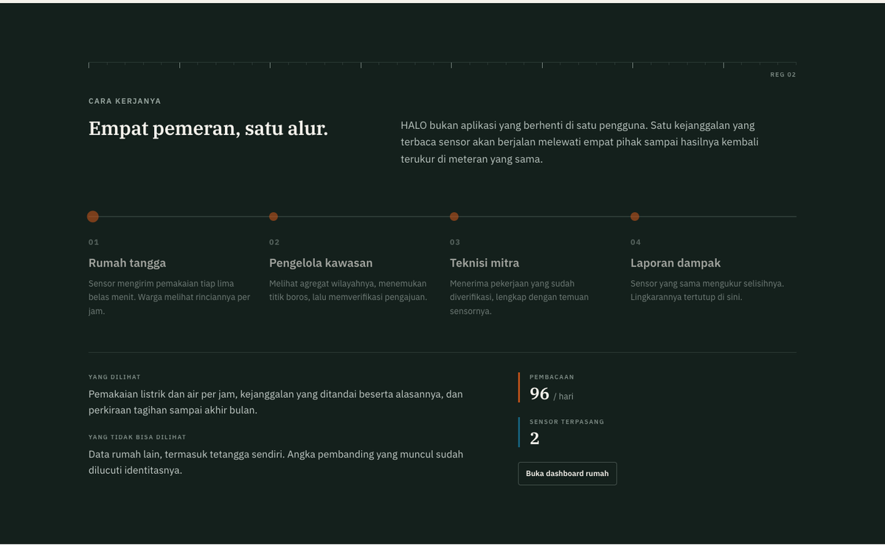
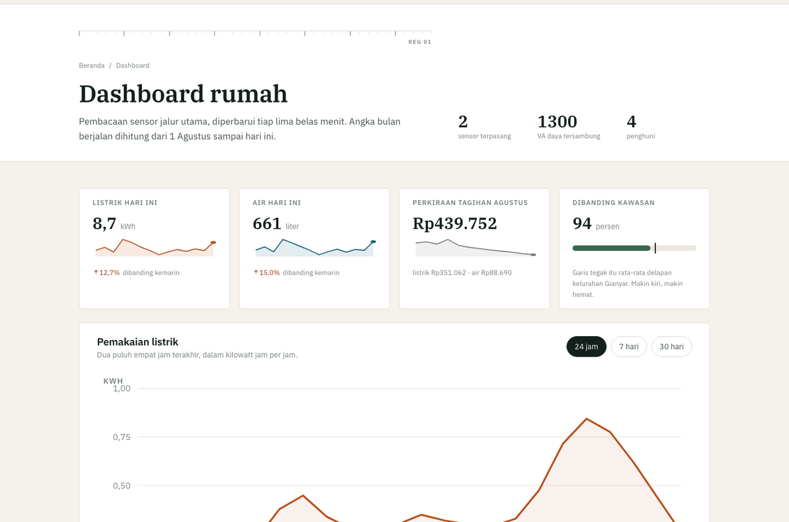
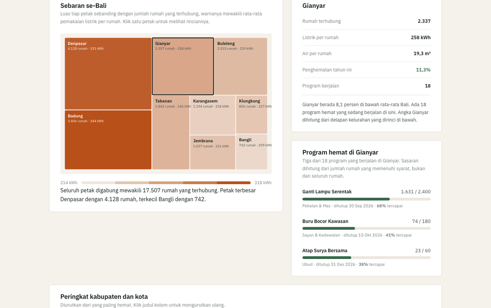
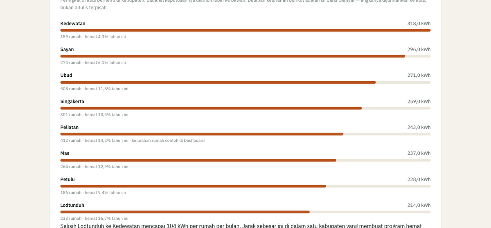
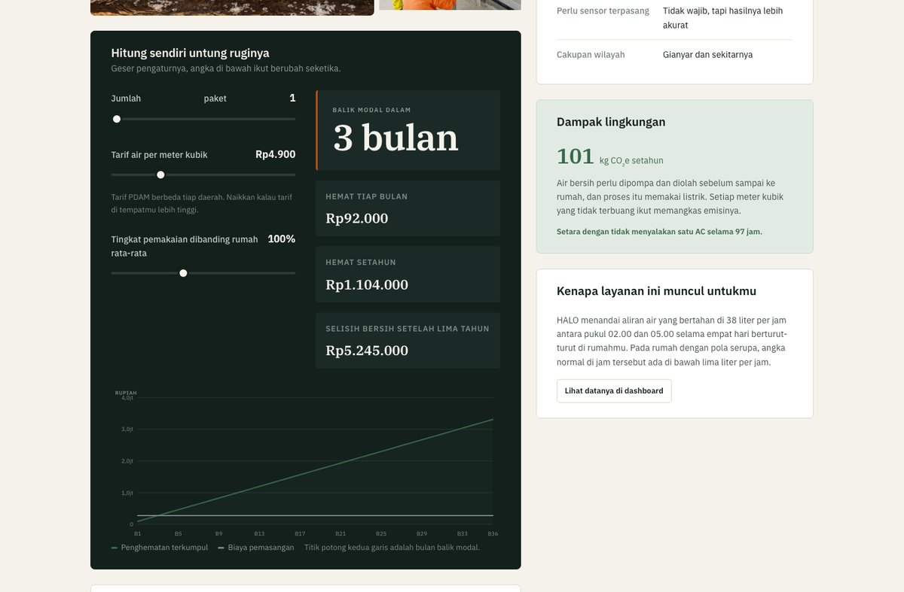
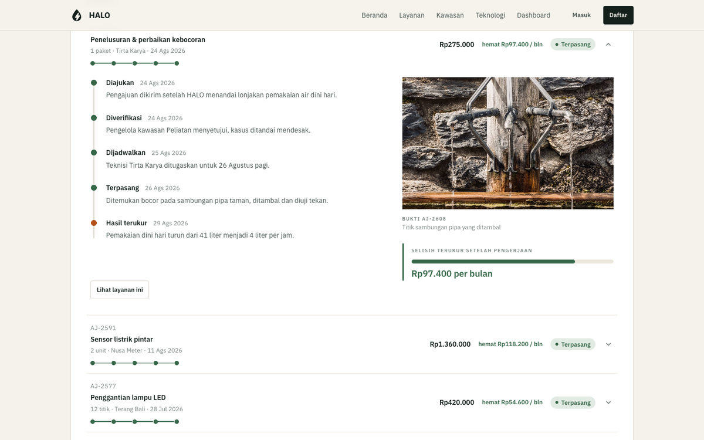
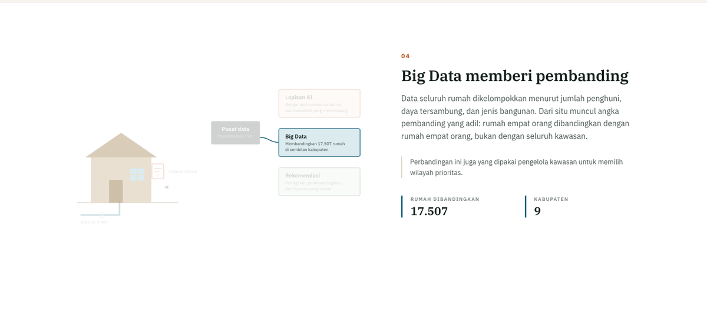
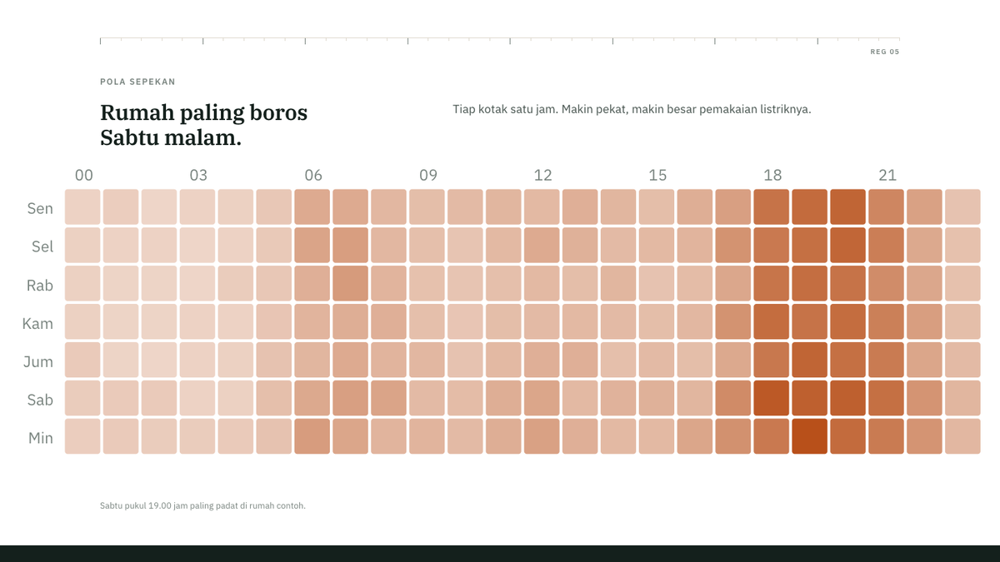
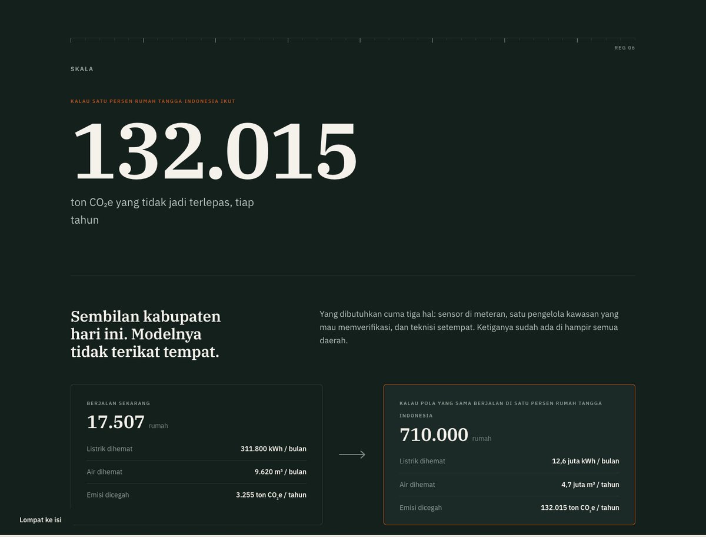

# HALO — Hemat Air dan Listrik Otomatis

Ekosistem pemantauan **listrik dan air rumah tangga**, dibuat untuk Lomba Web Design
ITCC 2026 kategori mahasiswa (perorangan), HMTI Universitas Udayana.

**Peserta:** Gianne Angely Puspa Pilatus — Teknik Informatika, Universitas Dhyana Pura
**Tema lomba:** *Synergizing Intelligence: Developing Integrated Web Ecosystems for Sustainable Global Impact*

🏆 **Peringkat 1 Babak Penyisihan** (nilai 258,3 dari tiga juri) · **Finalis 10 Besar Nasional**

🔗 **[halo-itcc2026.vercel.app](https://halo-itcc2026.vercel.app)**

`8 halaman` · `HTML/CSS/JS murni` · `tanpa framework` · `tanpa library grafik` · `nol permintaan internet`



---

## Apa yang dikerjakan situs ini

Kebanyakan situs sejenis berhenti sebagai dashboard: menampilkan angka, lalu selesai.
HALO menaruh **alur kerja empat pihak** di atas pemantauan itu, jadi satu temuan sensor
punya ujung yang terukur — bukan cuma grafik yang enak dilihat.



Warga mengajukan, pengelola kawasan memverifikasi, teknisi mengerjakan, lalu **sensor yang
sama mengukur ulang hasilnya**. Hasil pengukuran itu masuk kembali ke data warga sebagai
bukti, bukan sekadar klaim.

## Delapan halaman

| # | Halaman | Berkas | |
|---|---|---|---|
| 1 | Beranda | `index.html` | wajib |
| 2 | Masuk & Daftar | `pages/masuk.html` | wajib |
| 3 | Katalog layanan | `pages/layanan.html` | wajib |
| 4 | Detail layanan | `pages/detail-layanan.html` | wajib |
| 5 | Riwayat aktivitas | `pages/riwayat.html` | wajib |
| 6 | Dashboard rumah | `pages/dashboard.html` | bonus |
| 7 | Data kawasan | `pages/kawasan.html` | bonus |
| 8 | Cara kerja teknologi | `pages/teknologi.html` | bonus |

---

## Dashboard rumah

Pembacaan sensor jalur utama, diperbarui tiap lima belas menit. Pemakaian per jam,
kejanggalan yang terdeteksi, dan perkiraan tagihan sampai akhir bulan.



Grafik perkiraan tagihan sengaja **memutus garis sensor** di hari terakhir yang benar-benar
terbaca. Garis mendatar sampai akhir bulan akan menyiratkan sensor sudah membaca hari yang
belum terjadi.

## Data kawasan

Wilayahnya disusun dua tingkat. Tingkat atas sembilan kabupaten dan kota se-Bali:



Petak itu **treemap squarified** sungguhan — luas tiap petak sebanding dengan jumlah rumah
terhubung, warnanya mewakili rata-rata pemakaian listrik. Dua dimensinya sama-sama membawa
data, bukan kotak yang ukurannya ditentukan sembarangan.

Tingkat bawahnya delapan kelurahan di Gianyar, tempat verifikasi sebenarnya terjadi:



Baris Gianyar di tabel peringkat tidak ditulis tangan. Jumlah rumah, rata-rata listrik, air,
penghematan, dan jumlah programnya **dihitung dari delapan kelurahan itu**, jadi dua tingkatnya
tidak mungkin menunjukkan angka berbeda untuk wilayah yang sama.

## Detail layanan

Tiap layanan punya simulator sendiri. Geser pengaturannya, angka balik modal berubah seketika.



## Riwayat aktivitas

Jejak lima tahap tiap pengajuan, dari diajukan sampai hasilnya diukur ulang sensor —
lengkap dengan foto bukti dari teknisi.



## Cara kerja teknologi

AI, IoT, dan Big Data dijelaskan lewat diagram yang berpindah mengikuti guliran, bukan
lewat paragraf istilah.



---

## Grafik digambar sendiri

Lomba melarang library grafik, jadi `js/grafik.js` (±640 baris) menggambar semuanya sebagai
SVG dari nol:

| Fungsi | Bentuk | Dipakai di |
|---|---|---|
| `garis()` | Grafik garis, memutus pada data kosong | Tren bulanan, prediksi tagihan |
| `batang()` | Batang tegak | Perbandingan antar kelurahan |
| `batangDatar()` | Batang mendatar berlabel | Rincian per alat, rincian kelurahan |
| `cincin()` | Cincin satu angka | Skor efisiensi |
| `petaPanas()` | Peta panas hari × jam | Pola pemakaian sepekan |
| `kilau()` | Garis mungil tanpa sumbu | Deret angka di beranda |
| `aliranGanda()` | Grafik cermin dua satuan | Listrik dan air di hero |
| `petakData()` | Treemap *squarified* | Sebaran rumah se-Bali |



Peta panas di atas satu kotak mewakili satu jam. Makin pekat, makin besar pemakaiannya.

## Kaitan dengan tema



Skalanya sekarang satu provinsi, tapi modelnya tidak terikat tempat. Yang dibutuhkan cuma
sensor di meteran, satu pengelola kawasan yang mau memverifikasi, dan teknisi setempat.

Angka proyeksinya dihitung, bukan dikarang: rata-rata rumah yang sudah terhubung menghemat
17,8 kWh dan 0,55 m³ tiap bulan, dikalikan 710.000 rumah (satu persen rumah tangga Indonesia),
dikalikan faktor emisi jaringan Jawa–Bali 0,87 kg CO₂e per kWh.

---

## Yang ada di balik layar

**Satu sumber angka.** Seluruh situs menarik angka dari `js/data.js`. Ringkasan platform
diturunkan dari deretnya, bukan ditulis ulang, supaya Beranda, Dashboard, Kawasan, dan
Riwayat tidak pernah menampilkan angka yang bertentangan.

**Isi dulu, animasi belakangan.** Semua teks dan tabel ada di HTML. JavaScript hanya
memperkaya — kalau skrip gagal dimuat, halaman tetap terbaca utuh.

**Ramah semua orang.** Setiap animasi menghormati `prefers-reduced-motion`, tiap halaman
punya aturan cetaknya sendiri, dan navigasi papan ketik diuji sampai tuntas.

**Benar-benar offline.** Tidak ada satu pun permintaan ke internet. Tanpa CDN, font IBM Plex
pun disimpan di `assets/fonts`. Situs bisa dinilai di ruangan tanpa jaringan.

## Kepatuhan aturan lomba

| Aturan guidebook | Penerapan |
|---|---|
| HTML, CSS, JS murni — tanpa framework | Vanilla, tanpa tahap build |
| Hanya library dari daftar panitia | Boxicons 2.1.4, Fancybox 5.0.36, Swiper 11.1.5 — disalin ke `lib/` |
| Tanpa library grafik | Semua visualisasi SVG buatan sendiri di `js/grafik.js` |
| Tanpa backend atau basis data | Sesi dan rencana hemat disimpan di `localStorage` |
| Lima halaman wajib | Terpenuhi, ditambah tiga halaman bonus |
| Penamaan folder | `WD_MAHASISWA_[Nama]_ITCC 2026` dengan `_Website` dan `_Screenshot` di dalamnya |

Dari delapan library yang panitia izinkan, hanya tiga yang dipakai. jQuery, AOS, OwlCarousel,
Typed.js, dan GSAP sengaja ditinggalkan karena tidak ada yang perlu mereka kerjakan.

## Menjalankan di komputer sendiri

Klik dua kali `index.html` di dalam folder `Gianne Angely Puspa Pilatus_Website` sudah cukup.
Tapi supaya fitur daftar dan masuk berjalan penuh di semua peramban, jalankan server lokal:

```bash
cd "Gianne Angely Puspa Pilatus_Website" && python3 -m http.server 8000
```

Lalu buka `http://localhost:8000`.

> Sebagian peramban memblokir `localStorage` saat halaman dibuka lewat `file://`. Kalau itu
> terjadi situs tetap tampil utuh, hanya daftar/masuk yang tidak menyimpan.

## Mencoba tanpa mendaftar

Halaman **Masuk** menyediakan tiga tombol akun demo:

| Akun demo | Diarahkan ke | Yang bisa dilihat |
|---|---|---|
| Warga | Dashboard rumah | Pemakaian per jam, kejanggalan, perkiraan tagihan |
| Pengelola kawasan | Data kawasan | Petak se-Bali, peringkat kabupaten, rincian kelurahan, antrean verifikasi |
| Teknisi | Riwayat aktivitas | Daftar pekerjaan yang sudah lolos verifikasi |

Perannya ikut mengubah tampilan: antrean verifikasi hanya bisa diputuskan pengelola kawasan,
peran lain melihat tanpa tombol.

## Struktur folder

```
HALO-ITCC2026/
├── README.md
├── CATATAN-DESAIN.md               Alasan tiap keputusan desain
├── vercel.json                     Konfigurasi pratinjau
├── docs/img/                       Gambar untuk README ini
└── WD_MAHASISWA_Gianne Angely Puspa Pilatus_ITCC 2026/     ← yang dikumpulkan
    ├── Gianne Angely Puspa Pilatus_Website/
    │   ├── index.html              Beranda
    │   ├── pages/                  7 halaman lainnya
    │   ├── css/                    10 berkas gaya (±1.740 baris)
    │   ├── js/                     11 berkas skrip (±2.360 baris)
    │   ├── lib/                    boxicons · fancybox · swiper
    │   └── assets/                 fonts · img · ill
    └── Gianne Angely Puspa Pilatus_Screenshot/
        └── 8 tangkapan layar seluruh halaman
```

## Berkas lain

- [CATATAN-DESAIN.md](CATATAN-DESAIN.md) — alasan tiap keputusan desain, cara kerja grafik,
  dan bahan persiapan untuk babak final.

---

Data di situs ini simulasi. Pada sistem sungguhan angka-angkanya datang dari sensor IoT yang
terpasang di meteran listrik dan air.
